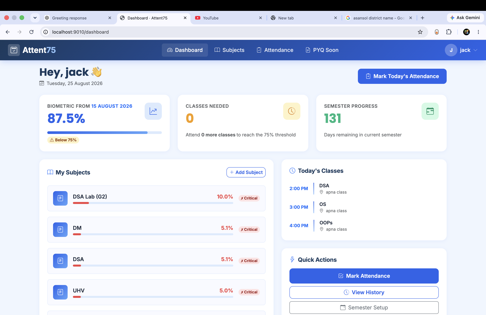
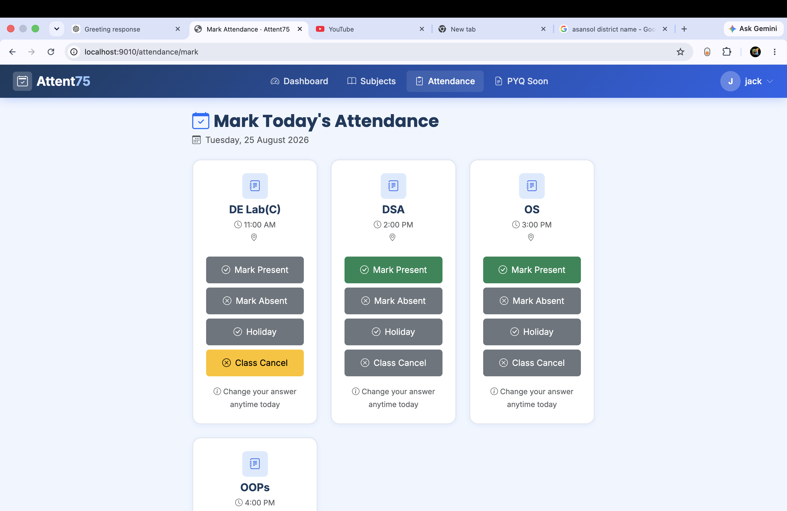
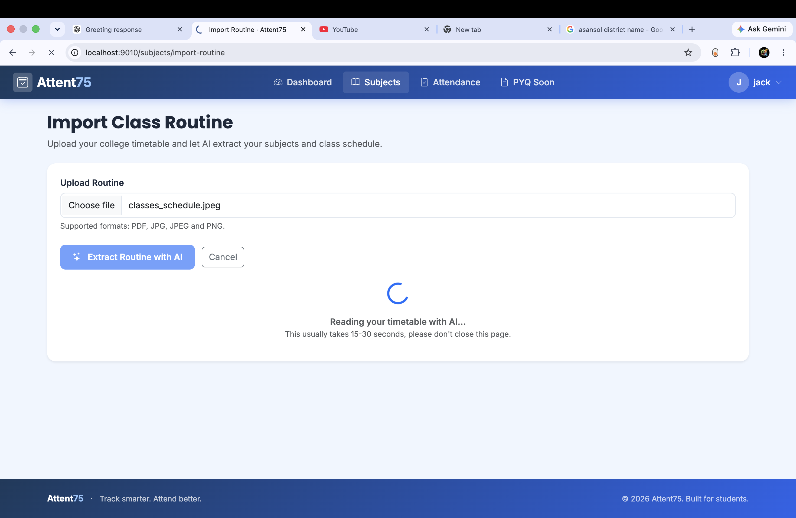
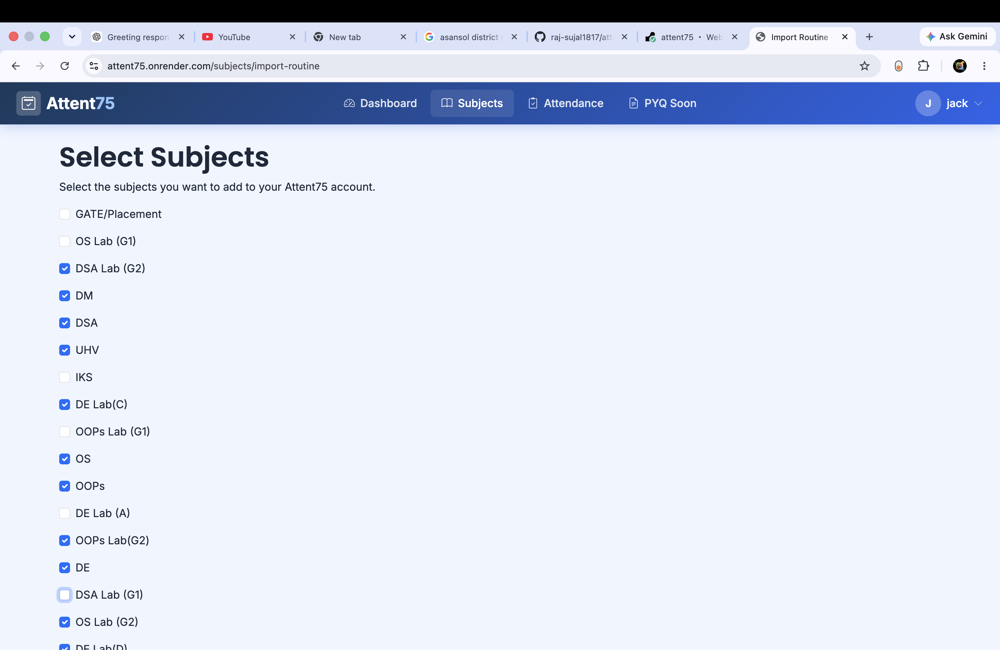

# 🎓 Attent75

### Smart Attendance Management for Students

> **Don't just track attendance — understand it.**

Attent75 is a smart attendance management system that uses a student's **semester schedule and scheduled classes** to calculate attendance, while AI simplifies the process of setting up the timetable from an existing college routine.

<p align="center">
  
</p>

---

## 🔐 Demo Access

Use the demo account below to explore Attent75 without creating an account.

| | Demo Credentials |

| **Email** | `jack3223@gmail.com` |
| **Password** | `jack3223` |

🚀 **[Open Attent75](https://attent75.onrender.com)**

> 💡 The demo account contains sample semester, subject and attendance data so judges can immediately explore the application's main features.

---

## 🚨 The Problem

Most basic attendance systems simply calculate:

**Present ÷ (Present + Absent)**

But real college attendance depends on more than just present and absent records.

Students deal with:

* Different subject schedules
* Semester start and end dates
* Holidays
* Cancelled classes
* Multiple subjects
* Manual timetable entry

Attent75 is designed around these real-world attendance situations.

---

## 💡 What Makes Attent75 Different?

### 📅 Semester-Aware Attendance

Attent75 uses the **semester start date, semester end date, and scheduled classes** to determine the attendance context.

```text
Semester Start
      ↓
📅 Scheduled Classes
      ↓
✏️ Attendance Marking
      ↓
┌──────────┬─────────┬──────────┬───────────┐
│ Present  │ Absent  │ Holiday  │ Cancelled │
└──────────┴─────────┴──────────┴───────────┘
      ↓
📊 Attendance Percentage
      ↓
Semester End
```

This makes attendance calculation **semester-aware instead of being only a simple running Present/Absent counter**.

### 🏖️ Real-World Class Handling

* 🟢 **Present** → Student attended the class.
* 🔴 **Absent** → Student missed the class.
* 🏖️ **Holiday** → Classes scheduled for that day are treated as a holiday.
* ❌ **Cancelled** → Cancelled classes are not treated as attended or missed.

<p align="center">
  
</p>

---

# 🤖 AI-Powered Routine Setup

Manually entering every subject and class schedule can be time-consuming.

Attent75 uses **Gemini AI** to analyze an uploaded college routine and convert it into structured schedule information.

```text
📄 College Routine
        ↓
    🤖 Gemini AI
        ↓
📚 Subjects + Schedule
        ↓
📝 Student Confirmation
        ↓
📅 Attent75 Schedule
```


---

# 🔄 How Attent75 Works

```text
👤 Student
    ↓
🔐 Login / Signup
    ↓
📚 Semester Setup
    ↓
📄 Upload Routine
    ↓
🤖 AI Routine Analysis
    ↓
📝 Select Subjects
    ↓
📅 Schedule Created
    ↓
✏️ Mark Attendance
    ↓
📊 Attendance Engine
    ↓
📈 Overall + Subject-wise Attendance
```

### Step 1 — Upload Routine

Upload the existing college routine instead of manually entering every class.

<p align="center">
  
</p>

### Step 2 — AI Analysis

Gemini analyzes the routine and extracts the relevant subjects and schedule.


### Step 3 — Select Subjects

Review the detected subjects and select the subjects to track.

<p align="center">
  
</p>

### Step 4 — Track Attendance

Mark classes as Present, Absent, Holiday, or Cancelled.

<p align="center">
  
</p>

### Step 5 — Monitor Attendance

View overall and subject-wise attendance from the dashboard.

<p align="center">
  
</p>

---

# ✨ Key Features

* 🤖 **AI Routine Parsing** — Extract subjects and schedules from an uploaded routine.
* 📅 **Semester-Aware Attendance** — Attendance is calculated with respect to the semester schedule.
* 📊 **Overall & Subject-Wise Tracking** — Monitor attendance at both levels.
* 🏖️ **Holiday Handling** — Mark a complete scheduled day as a holiday.
* ❌ **Cancelled Class Handling** — Separate cancelled classes from attended/missed classes.
* 🗓️ **Attendance History** — Review previous attendance records.
* 📚 **Semester & Subject Management**
* 🔐 **User Authentication**

---

# 🚀 Coming Soon

* 📚 **PYQ Resources** — UI available; functionality under development.
* 🎯 **Classes Required for 75%**
* 🎯 **Short-Term Attendance Goals**
* 🔮 **Attendance Prediction**
* 🔔 **Smart Attendance Notifications**

---

# 🏗️ System Architecture

```text
                         👤 STUDENT
                              │
                              ▼
                  ┌──────────────────────┐
                  │    Attent75 Web UI   │
                  │   HTML / CSS / JS    │
                  │        + EJS         │
                  └──────────┬───────────┘
                             │
                             ▼
                  ┌──────────────────────┐
                  │    Express + Node.js │
                  │       Backend        │
                  └──────────┬───────────┘
                             │
               ┌─────────────┴─────────────┐
               │                           │
               ▼                           ▼
      ┌──────────────────┐       ┌──────────────────┐
      │  Attendance      │       │    Gemini AI     │
      │     Engine       │       │  Routine Parser  │
      └────────┬─────────┘       └────────┬─────────┘
               │                          │
               │                          ▼
               │                  Structured Schedule
               │                          │
               └────────────┬─────────────┘
                            ▼
                   ┌──────────────────┐
                   │   MongoDB Atlas  │
                   │                  │
                   │ Users            │
                   │ Semester Data    │
                   │ Subjects         │
                   │ Schedule         │
                   │ Attendance       │
                   └──────────────────┘
```

### 🔄 Core Data Flow

```text
Routine
  ↓
Gemini AI
  ↓
Structured Schedule
  ↓
Semester + Subject Data
  ↓
Attendance Engine
  ↓
Present / Absent / Holiday / Cancelled
  ↓
Attendance Percentage
  ↓
Dashboard
```

---

# 🛠️ Tech Stack

| Layer           | Technology                 |
| --------------- | -------------------------- |
| Frontend        | HTML, CSS, JavaScript, EJS |
| Backend         | Node.js, Express.js        |
| Database        | MongoDB Atlas              |
| AI              | Gemini API                 |
| Authentication  | bcrypt, Express Session    |
| Deployment      | Render                     |
| Version Control | Git, GitHub                |

---

# 🌐 Live Demo

🚀 **[Try Attent75](https://attent75.onrender.com)**

---

# ⚙️ Run Locally

### Clone the repository

```bash
git clone https://github.com/raj-sujal1817/attent75
cd Attent75
```

### Install dependencies

```bash
npm install
```

### Configure environment variables

Create a `.env` file:

```env
MONGO_URI=your_mongodb_connection_string
SESSION_SECRET=your_session_secret
GEMINI_API_KEY=your_gemini_api_key
PORT=3000
```

### Start the application

```bash
npm start
```

> ⚠️ Never commit `.env` or API credentials to the repository.

---

# 🏆 Hack4Bhrama 2026

### Attent75

> **Making student attendance management smarter, simpler, and more meaningful.** 🎓
